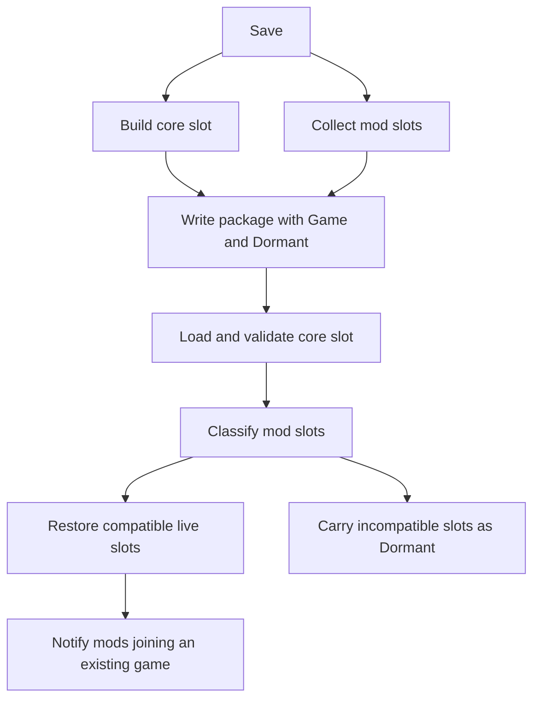

# Save system

A `SavePackage` contains a reserved `__core__` slot, mod-owned slots in `ModData`, the game composition snapshot in `Game`, and preserved inactive slots in `Dormant`. The kernel routes blobs to their owners; it does not interpret their payloads.

## Where saves live

A game's saves and PNG thumbnails live in `user://saves/<game_id>/`. The save browser supports an unlimited list; `slot_1`, `slot_2`, … are logical names, not a hard slot limit. Development runs without a game retain the unscoped saves directory. `Game` records the collection's ID, name, version and mod versions at save time; this snapshot does not force the old composition to be reinstalled.

## Save and load

Loading first requires a valid core slot. It then classifies each mod slot against the **loaded** mod set and versions, restores core state, and dispatches compatible mod data. A slot whose mod is missing, downgraded, requires a newer core, or rejects its payload is retained as dormant; these mod-local problems do not abort the entire load. The reasons are `NotLoaded`, `Downgrade`, `CoreTooOld`, `LoadFailed`.

Dormant data is written forward unchanged and can revive when the compatible mod returns. New mechanics without restored data start from new-game defaults and receive `IModSaveable.OnJoinedExistingGame()`. The save settings provide explicit dormant-data cleanup (`SaveService.PurgeDormantData()`); data is otherwise retained. Unresolved item and quest records are also retained by their owners rather than silently lost.

## State ownership

The core currently keeps time, lamp, skills/action pool, completed scenarios, world-map overrides and story flags. Characters, inventory, recipes, quests, RPG position, stats, equipment, recruits and NPC background history each have their own mod slots. There is no active-battle snapshot or automatic saving of concurrent speech execution pointers.

Removing a mechanic from a game's collection therefore preserves its save slot for a later return. This does not convert old saves from before a subsystem moved out of `__core__`: see [Versioning](versioning.md).

## Mod contract

Implement `IModSaveable`; discovery supplies one slot per mod. The core fills `ModId`, `ModName`, `ModVersion`; the mod sets `MinCoreVersion`, optional `CustomData`, and `Data`. There is no `IsRequired` field in the current metadata DTO. Use versioned blobs, handle missing keys, and keep another mod's state out of your own payload.

`__core__` remains reserved; a mod cannot replace it. Scene navigation after loading uses the core preview's `CurrentSceneName`, while mod state restores before gameplay resumes.

- [Data model](data-model.md) — package, slot ownership, blobs and preview fields.
- [Mod API](api.md) — save handlers, migrations and save-browser methods.
- [Versioning and compatibility](versioning.md) — version comparison and dormancy.
