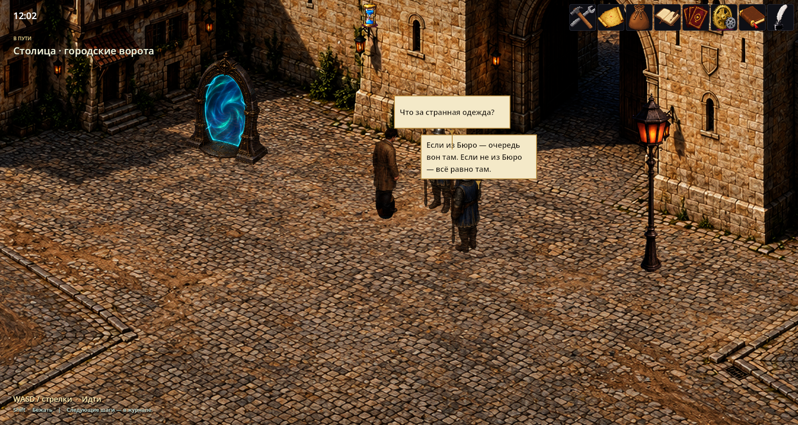
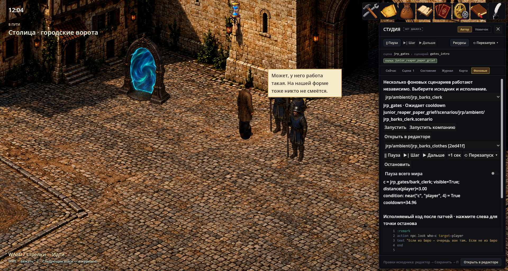

# Background NPC scenarios

`npc_barks_base` hosts concurrent `.scenario` programs on RPG maps. Speech appears above NPCs while the player can keep walking. Each execution uses the shared `dialog_base` parser and its own `DialogRuntime`, variables, waits, roles and debugger. It does not occupy the modal dialog box. The mod is a prototype; its supported command subset is deliberately limited.



## Defining a conversation

The game must include `npc_barks_base` and supply the actor placements named below. Put the file in `scenarios/ambient/greeting.scenario`:

```scenario
scene: my_meadow
channel: ambient
actor.guard: my_meadow/guard
anchor: guard
condition: near("guard", "player", 4)
cooldown: 30
once: false
priority: 0
---
:greet
action npc.look who=guard target=player
text "Good evening." who=guard duration=3 cue=guard_greeting
end
```

The definition ID is its path relative to `scenarios/` without the extension: `ambient/greeting`. This is distinct from the modal scene-chain scenario identity. Translate speech with ordinary `key=` entries.

| Header | Meaning |
|---|---|
| `channel: ambient` | Selects the background host; omitted channel means ordinary modal dialog |
| `scene` | Required RPG map ID |
| `actor.<role>` | Required owned participant; full placement ID must start with `<scene>/` |
| `anchor` | An owned role, defaulting to the first role; supplies the default speaker and `self.` scope |
| `condition` | Admission condition in this execution's spatial context |
| `cooldown` | Nonnegative finite seconds after completion, default 30 |
| `once` | Save completion history and stop admitting the definition after success, default false |
| `priority` | Lower first; equal priority sorts by definition ID |
| `on`, `cue`, `source_actor` | Optional reaction to a speech cue; see below |

Actors must exist, be visible and be stationary. Owned participants are reserved together: two conversations cannot own the same actor at once. Disjoint conversations can run concurrently (up to 32). Their actors' routes are held until completion or interruption. E/F interaction with a participant interrupts its bark and releases it for the player's dialog.

## Commands and spatial conditions

Supported commands are `text`, `ptext`, `when`, `goto`, `delay`, `flag`, `set`, `cset`, `end`, and **only** `action npc.look`. Modal choices, scene switches, battles, inventory actions and arbitrary `action` names are rejected during ambient compilation. `wait=false` on speech is rejected.

`who=` selects an owned speaker role; `duration=` is a positive finite reading time in seconds. Without a duration, the host estimates 2–8 seconds from text length. `cue=` emits speech events. `npc.look who=<owned_role> target=<role|player|source>` keeps that actor facing the target while the run owns it.

Conditions share the story condition grammar and add:

| Condition | Prototype meaning |
|---|---|
| `near("guard", "player", 4)` | Euclidean distance within an integer radius of 0–1000 logical cells |
| `visible("guard")` | Participant exists and is logically visible; not a camera or wall visibility test |
| `moving("player")` | Whether that resolved actor is currently moving |
| `can_hear("guard", "source")` | Distance within 8 cells; no wall or door acoustics |

`player` and `source` are reserved roles, not names for `actor.*` declarations. `source` resolves to the actor whose speech triggered a reaction.

`when` can wait for a live condition instead of branching once:

```scenario
when "!near(\"guard\", \"player\", 5)" wait=true timeout=8 else=still_here -> :left
:still_here
text "Still here?" who=guard
end
:left
text "There they go." who=guard
end
```

`timeout` must be positive and finite. The success arrow and `else` target are optional; a missing target continues to the next line. The modal host also supports this wait form.

## Responding to speech

A second definition can declare:

```scenario
scene: my_meadow
channel: ambient
actor.vendor: my_meadow/vendor
on: speech.finished
cue: guard_greeting
source_actor: my_meadow/guard
condition: can_hear("vendor", "source")
cooldown: 30
---
:reply
action npc.look who=vendor target=source
text "Evening!" who=vendor duration=2
end
```

`on` accepts `speech.started` or `speech.finished` and requires `cue`. `source_actor` optionally filters by exact placement ID. Reactions are deferred to the next world update; old-session events, duplicate events, events older than two simulation seconds and reaction depth beyond eight are discarded. An interruption emits `speech.interrupted`, not a false finish; this phase is not an accepted reaction trigger.

## Patching a labeled block

Place a patch under `patches/scenarios/` and depend on the definition's owner:

```scenario
patch_of: ambient/greeting
replace: greet
---
text "The market closes soon." who=guard duration=3
end
```

`replace` preserves the label and replaces its body up to the next label; it cannot introduce labels. `remove: greet` removes the labeled block. `append_blocks: true` appends explicitly labeled blocks, provided the original body ends with `end`. Patches address stable labels, never line numbers. Compilation rejects duplicate labels and missing jump targets. This patch mechanism belongs to the ambient host.

## Editing, debugging and persistence

Scenario Editor validates background buffers and can preview one scenario or its company of nearby scenarios. Save publishes source changes; existing runs keep their compiled program until restarted. Scenario Studio's **Background** tab lists definitions and their admission status separately from running executions. Select a run to pause, step, continue, advance its clock by a second, stop or restart it. Source IDs select breakpoints; run IDs select one execution.



Menus and ordinary blocking tools pause the simulation and reading timers. The background authoring tools use observation mode; Studio also has an explicit whole-world pause. Scene exit, world replacement and applied mod reload abort transient runs and release their participants.

The `npc_barks_base` save slot stores a `History` blob: completed definition IDs and remaining cooldowns. Bubbles, execution pointers and queued speech events are not saved or replayed; active runs receive a small cooldown on save. An aborted run is not marked completed. Flags remain ordinary saved game flags.

Implementation: `mods/npc_barks_base/src/` and `mods/dialog_base/src/IScenarioExecutionHost.cs`. The authoring seam is `BackgroundScenarios.Provider` / `IBackgroundScenarioTools`. Tests: `npc_barks` and `npc_barks_tools` in the test manifest.
